# Praktikum 4 - CSS Layout

## Identitas
- Nama: [Nama Kamu]
- NIM: [NIM Kamu]
- Kelas: [Kelas Kamu]
- Mata Kuliah: Pemrograman Web

## Tujuan Praktikum
1. Memahami struktur dasar layout website.
2. Memahami konsep box element.
3. Memahami CSS float dan clear.
4. Memahami HTML5 semantic element.
5. Membuat layout website sederhana.

## Langkah 1 - Box Element
Membuat kotak menggunakan tag div dan mengatur
warnanya menggunakan CSS.

## Langkah 2 - CSS Float dan Clear
Mencoba properti float untuk mengatur posisi elemen
dan clear untuk mengatur posisi elemen berikutnya.

## Langkah 3 - Layout Website
Membuat header, navigasi, hero panel, main content,
sidebar, dan footer menggunakan HTML dan CSS.

## Langkah 4 - Halaman About
Membuat halaman profil yang berisi deskripsi
dan portofolio sederhana.

## Langkah 5 - Halaman Contact
Membuat formulir kontak dengan kolom nama,
email, pesan, dan tombol kirim.

## Hail Screenshot
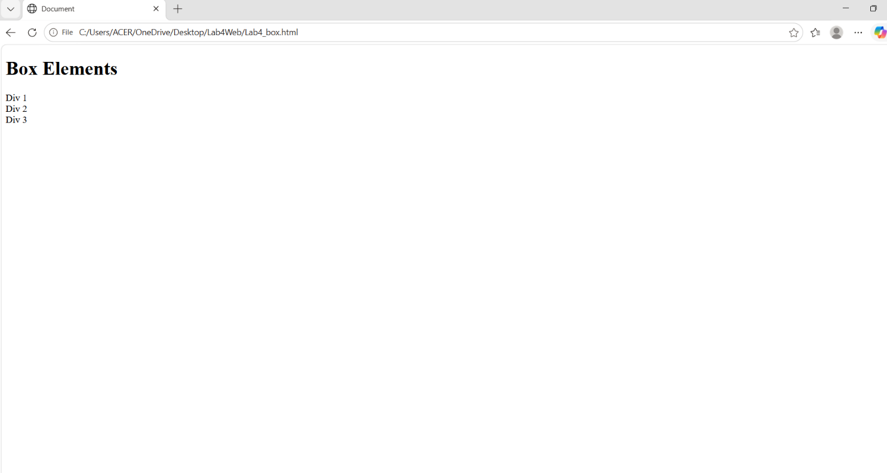

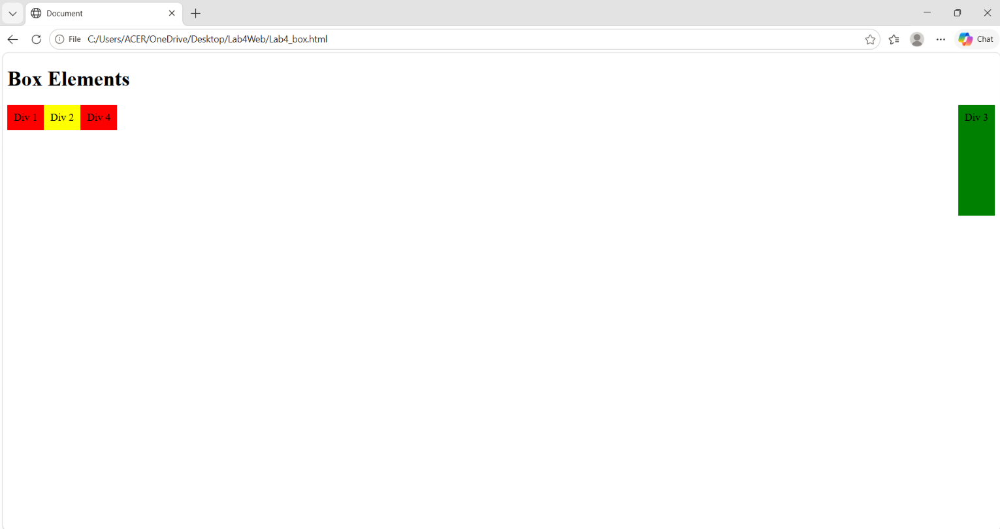

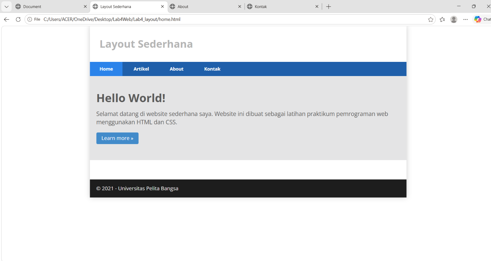

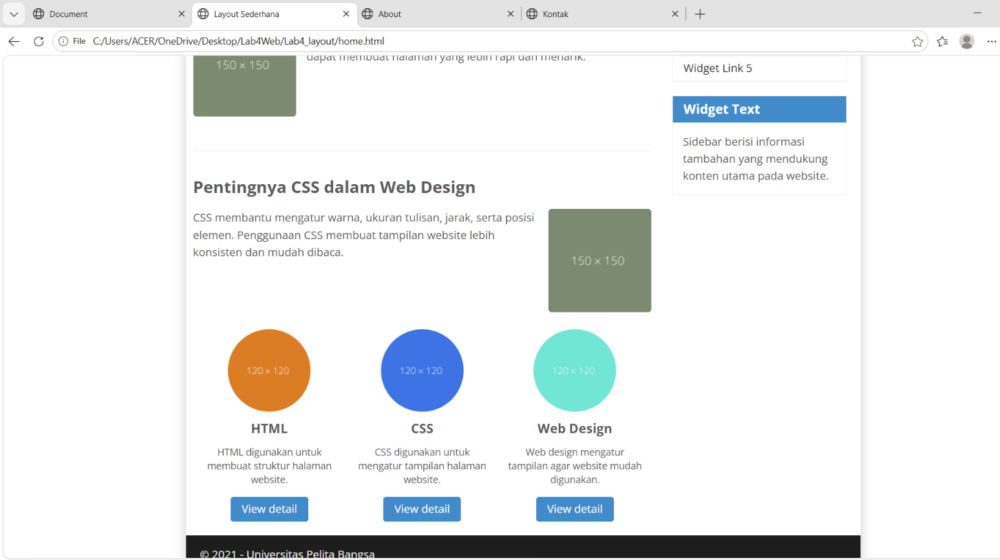

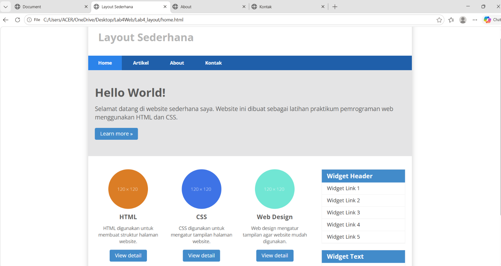

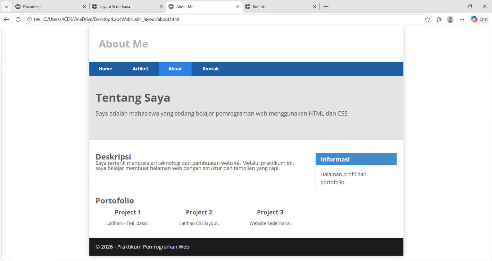

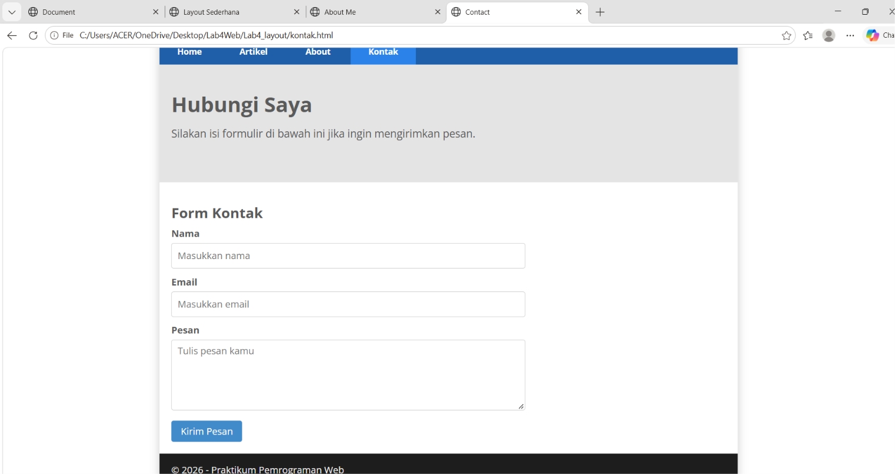

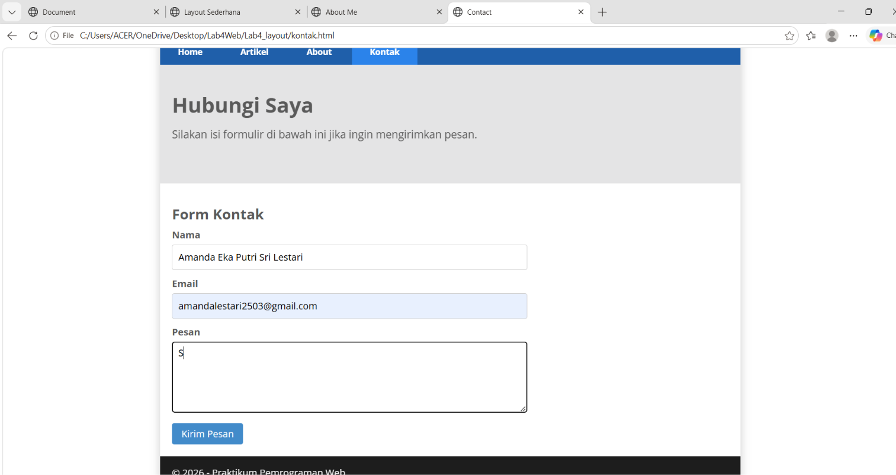

## Hasil Validasi
1. hasil validasi home.html
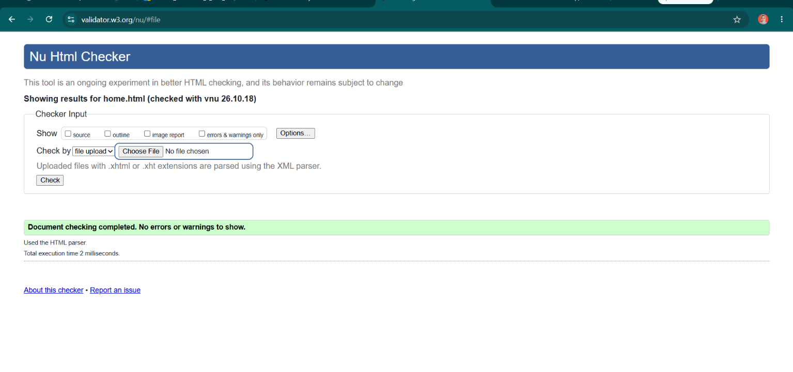

2. hasil validasi about.html
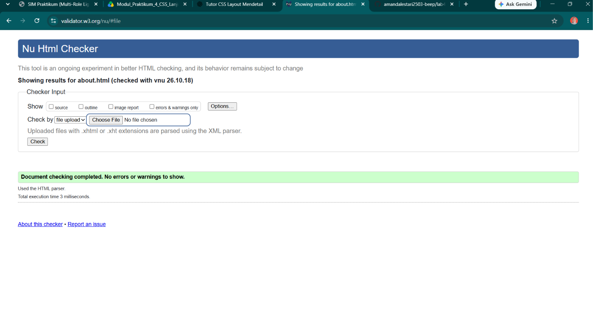

3. hasil validasi kontak.html
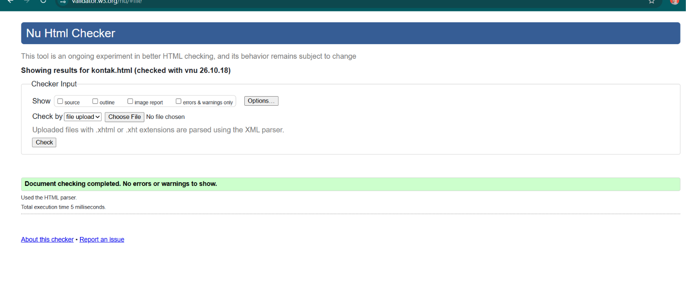

## Kesimpulan
Melalui praktikum ini, saya belajar membuat layout
website menggunakan HTML dan CSS, mengatur posisi
elemen, serta membuat halaman About dan Contact.
